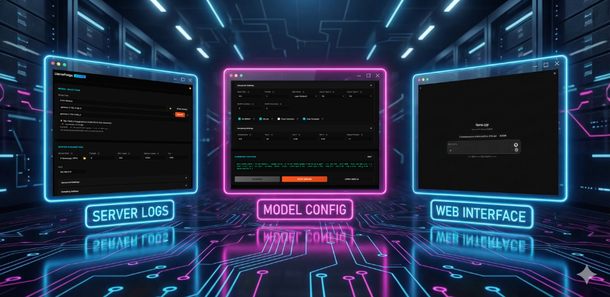

# LlamaForge 🛠️
### The Ultimate Command Center for Local LLMs

  

**Stop wrestling with command-line flags. Start forging intelligence.**

LlamaForge is a professional-grade Graphical User Interface (GUI) for [llama.cpp](https://github.com/ggerganov/llama.cpp). It transforms the complex process of running local Large Language Models (LLMs) into a streamlined, point-and-click experience without sacrificing the power-user controls you need.

---

## 🚀 Features

*   **🧠 Smart Runtime Detection**: LlamaForge automatically scans your system for compatible DLLs (CUDA, ROCm, Vulkan) and only enables valid backends. No more crashes due to missing drivers.
*   **⚡ Instant Backend Forcing**: Want to force Vulkan over CUDA? CPU over ROCm? LlamaForge handles the complex environment variable overrides (`CUDA_VISIBLE_DEVICES`, `HIP_VISIBLE_DEVICES`) instantly.
*   **📡 Real-Time Telemetry**: View color-coded, streaming server logs directly in the UI. Track tokens per second, context loading, and errors as they happen.
*   **📂 Model Arsenal**: Recursively scans your directories for `.gguf` files. Select, load, or delete models from a clean dropdown menu.
*   **🛠️ Command Forge**: See the exact command being generated. Edit it manually before execution for total control.
*   **⬇️ Built-in Downloader**: integrated access to HuggingFace for grabbing new models.

## 📦 Installation

**No Python. No Dependencies. It just works.**

1.  Download the latest `LlamaForge_Beta.zip` from the [Releases](https://github.com/mordang7/LlamaForge/releases) page.
2.  Extract the folder.
3.  Run `LlamaForge.exe`.
4.  Point it to your `llama-server.exe` (part of llama.cpp) and your Model folder.
5.  **Forge.**

## 🎮 Usage

1.  **Select Runtime**: Choose between Auto, CUDA (NVIDIA), ROCm (AMD), Vulkan, or CPU.
2.  **Pick a Model**: Select a `.gguf` file from your scanned list.
3.  **Tune Parameters**: Adjust Context Size, GPU Layers, and Threads with visual sliders.
4.  **Launch**: Click "Start Server". The dashboard lights up with your API endpoint and live logs.

## 🤝 Support the Project

If LlamaForge has saved you time or helped you run your local AI setup, consider supporting the development!

---

*Built for the community, by the community.*